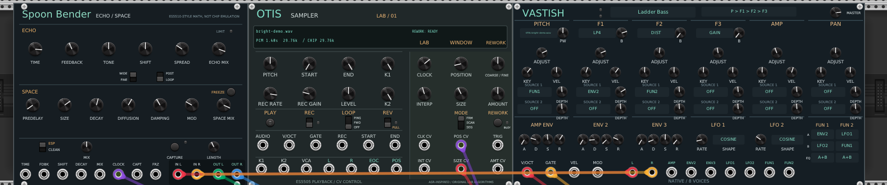

# DSP_Emulation

Three modules for VCV Rack 2, built around early digital instruments and usable on their own or as one chain:

| Module | What it does | Manual |
|---|---|---|
| **OTIS Sampler** | Records or loads a mono or stereo sample and plays it through an ES5505-derived engine, with variable chip clock, short-loop scanning and destructive loop reworking. | [OTIS manual](vcv/otislab/docs/MANUAL.md) |
| **Vastish** | Eight-voice synthesizer in the style of Kurzweil VAST: three DSP blocks per voice, six routings, envelopes, LFOs, FUN processors, and sample playback from OTIS. | [Vastish manual](vcv/vastish/docs/MANUAL.md) |
| **Spoon Bender** | Stereo echo with a frequency shifter in its feedback loop, an eight-line reverb with freeze, an optional ES5510-style fixed-point engine, and CAPTURE, which turns the last few seconds into an OTIS sample. | [Spoon Bender manual](vcv/spoonbender/docs/MANUAL.md) |

Placed side by side as **Spoon Bender → OTIS → Vastish**, they pass samples along: a Spoon Bender capture becomes an OTIS sample, and OTIS's sample becomes a Vastish oscillator. Audio still travels through cables.

## Download

**[Latest preview release](https://github.com/JosiahAlanLee/DSP_Emulation/releases)**: one zip per platform, each holding all the plugins and an INSTALL.txt. preview-1 predates Séance; the next release includes it.

| Platform | File |
|---|---|
| Windows x64 | `DSP_Emulation-<release>-Windows-x64.zip` |
| Linux x64 | `DSP_Emulation-<release>-Linux-x64.zip` |
| macOS Apple Silicon (M1 and later) | `DSP_Emulation-<release>-macOS-AppleSilicon.zip` |
| macOS Intel | `DSP_Emulation-<release>-macOS-Intel.zip` |

Install steps and exact file names: **[Getting started](docs/GETTING_STARTED.md)**.

Status: Linux has been used live in Rack. Windows and macOS builds compile and pass the portable engine tests in CI but nobody has run them inside Rack yet; reports are welcome in [Issues](https://github.com/JosiahAlanLee/DSP_Emulation/issues). The modules aren't in the VCV Library yet.

## Séance: a spectral frame held by a row of modules

[`vcv/seance`](vcv/seance) is a spectral core with five expanders. The core takes a short-time Fourier frame of its input, hands it to whatever Séance expanders sit directly to its right, and resynthesises what comes back: one analysis, one resynthesis, any number of in-place operations between, applied left to right. The row holds the full spectral frame in common, the way a SuperCollider `PV_` chain or a Pd `block~` subpatch does.

- **Freeze** holds the frame with its phases still turning; **Scramble** moves every partial by a seeded offset, re-pitched coherently; **Cross** lets a second input's spectrum decide the first's levels (vocoding, morphing); **Wipe** is a wall across the spectrum that sweeps under CV.
- **Bridge** reports eight bands of spectral activity as a byte bus and applies incoming bits as a smoothed band mask; [OTIS feedback example](vcv/seance/docs/BYTE_BUS.md).
- **SEED** and **RESET** make every texture a pure function of the seed and the frame count, so a Gorgon score replays the same frames every time.
- Latency is the frame size minus one plus 64 samples, fixed, with the dry path delayed to match.

For example: OTIS → Séance (Freeze, Scramble) → Spoon Bender → CAPTURE → OTIS turns destructive loop reworking into resampling through the patch.

Status: new, built and tested in CI (engine and module tests), and loaded and run headless in Rack on Linux, but not yet played live. Included in the release bundles from the next release; preview-1 predates it. [Manual](vcv/seance/docs/MANUAL.md).

## Also in this repository

- **[DrumLab Percussion](vcv/drumlab)**: six original percussion models with controls captured per hit and a four-lane kit for Gorgon. New synthesis prototype, built separately; outside the release bundles. [Manual](vcv/drumlab/docs/MANUAL.md).
- **[ByteBusLab](vcv/bytebus)**: Clocked Register supplies state; Counter counts, as a divider chain or an address; Lookup supplies original waveform, CV, Walsh and rhythm transforms, plus Vastish table import. Built separately; outside the release bundles.
- **Gorgon**, the Rack bridge to the Gorgon tracker in [HydraPy](https://github.com/JosiahAlanLee/hydrapy) Studio, was developed here as `vcv/gorgon` and now lives in [its own repository](https://github.com/JosiahAlanLee/Gorgon) with its history, alongside the contract it implements. Its gates and pitch were built to drive OTIS and Vastish.
- [`pd/vastish`](pd/vastish): the original Vastish, a VAST-style eight-voice synth in vanilla Pure Data (0.52+).
- [Development guide](docs/DEVELOPMENT.md): building from source, the Rack SDK, tests and how the engines are validated.
- [Panel guide and current GUI images](docs/PANELS.md): panel conventions, control layouts and artwork regeneration.

Kurzweil, VAST, Ensoniq and EPS are their owners' trademarks. These are independent emulations, not affiliated with or derived from manufacturer code, firmware or samples. OtisLab's playback arithmetic is adapted from MAME (BSD-3-Clause, Aaron Giles); see its THIRD_PARTY_NOTICES.

### Machinemodule Rack prototype

[`vcv/machinemodule`](vcv/machinemodule) wraps the pinned Machinemodule core in a
separate AGPL plugin with Gorgon sound locks, eight polyphonic parameter CV inputs
and optional MDS1 ROM sample memory. A user-supplied OS is required. The original
DrumLab synth and other plugins retain their existing licenses. See the adapter
README for timing, validation and current sampling limits.
Its dedicated CI builds Windows x64, Linux x64 and both Mac architectures;
live Machinedrum OS testing has been performed on Linux.
