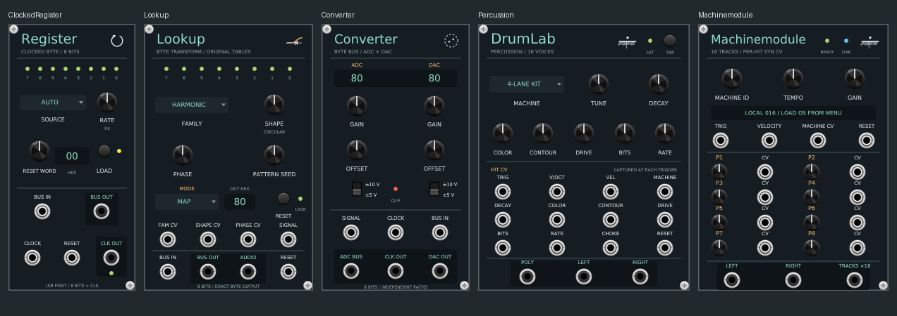

# VCV panel guide

The newer instruments follow the same panel language as OTIS, Vastish, Spoon
Bender and Séance: dark blue-grey panels, mint titles and outputs, amber section
labels, pale control labels, and darker blocks around outputs. The twelve
[panel marks](../vcv/shared/glyphs/README.md) identify the modules.



These are actual module-browser renders from Rack Free 2.6.4 on Linux. The
browser illuminates indicators for its previews; the lights above do not show a
running patch. Machinemodule requires a user-supplied OS to make sound.

| Panel | Width | GUI details | Generated layout illustration |
|---|---|---|---|
| Clocked Register | 12 HP | Named clock source selector, held-word hex display, separate bus and clock outputs | [Register](../vcv/bytebus/docs/Register-preview.svg) |
| Lookup | 16 HP | Named family and Map/Rise/Fall selectors, output hex display, grouped bus/audio outputs | [Lookup](../vcv/bytebus/docs/Lookup-preview.svg) |
| Converter | 14 HP | Independent ADC/DAC readouts, gain/offset/range controls, grouped outputs | [Converter](../vcv/bytebus/docs/Converter-preview.svg) |
| DrumLab Percussion | 20 HP | Named machine selector, TAP audition, separate sound controls, hit CV and audio rows | [Percussion](../vcv/drumlab/docs/Percussion-preview.svg) |
| Machinemodule | 18 HP | Local machine ID/name readout, labelled Ready/Link indicators, eight offset/CV pairs, grouped outputs | [Machinemodule](../vcv/machinemodule/docs/Machinemodule-preview.svg) |

The machine readout describes the local selector. A patched machine CV or an
incoming Gorgon sound lock can select a different machine per hit. P1–P8 remain
raw offsets; machine-specific parameter names are available in the existing
module menu. The readout gets names from the loaded OS.

The panel update preserves all parameter, port and light IDs, patch data and
module widths. Existing patches keep their connections and values. Moving the
controls changes where their cables are drawn.

## Regenerate artwork

Use a complete repository checkout, Python 3, `fontTools` and DejaVu Sans.
The generated SVGs contain outlined labels: NanoSVG, Rack's panel renderer,
does not draw SVG `<text>`. DejaVu's license accompanies each affected plugin.
No font installation or Python is needed to use the built plugins.

From the repository root:

```sh
python vcv/bytebus/tools/make_panels.py
python vcv/drumlab/tools/make_assets.py
python vcv/machinemodule/tools/make_panel.py
python vcv/seance/tools/make_panel.py
```

The first three use [the shared panel helper](../vcv/shared/panels/panel.py).
Each component table generates both the artwork and `src/Layout.hpp`, consumed
by the module widget, plus a component illustration in the plugin's `docs`
directory. Commit all generated outputs together. The old
`make_converter_panel.py` entry point regenerates the whole ByteBusLab family.
An alternate font file can be passed to these three generators with `--font`.
The component illustrations are layout aids, not Rack screenshots.

Keep layout namespace imports inside widget constructors. Qualify shared names
such as `WIDTH` so integration tests can compile several adapters together.

Séance already follows this style; its narrow Cross switch legends now sit
inside the 4 HP panel border. The established OTIS, Vastish and Spoon Bender
generators remain in their respective `tools` directories.

## Validation for this update

Linux builds for ByteBusLab, DrumLab and Machinemodule pass. All six ByteBusLab
engine/module checks, DrumLab's engine/module/Gorgon checks, and Machinemodule's
six firmware-free CTest checks pass. Séance's engine/module/Bridge checks also
pass, including the native OTIS/Lookup feedback integration and ASan/UBSan
checks. Local sanitizer runs disable leak detection because this host cannot
inspect process threads. Rack's own screenshot mode loads and draws
all five updated module widgets and all six Séance panels, including browser
previews without a module instance. Live pointer/keyboard interaction and
physical audio/CV devices were not part of this check.
