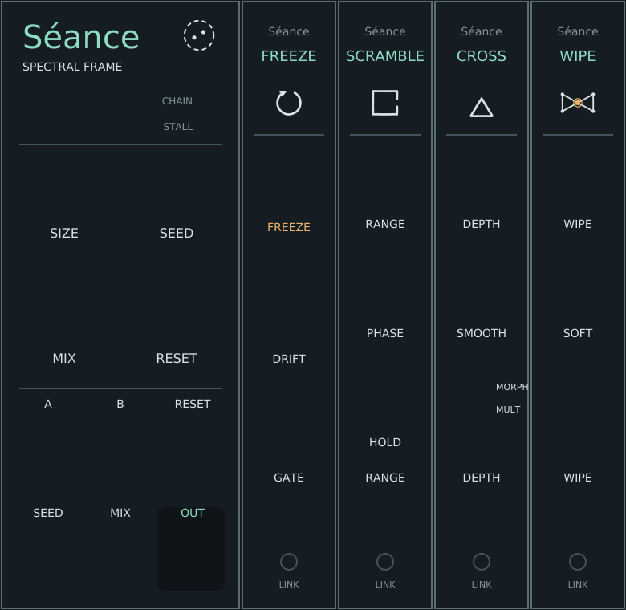

# Séance

A spectral core and four expanders for VCV Rack 2. The core takes a short-time Fourier frame of its input, hands it to whatever Séance expanders sit directly to its right, and resynthesises whatever comes back. One analysis, one resynthesis, any number of in-place operations between, applied left to right: the SuperCollider `PV_` chain or a Pd `block~` subpatch, in Rack's expander idiom. Nothing spectral travels down a cable; the frame is held in common by the row.

See the [manual](docs/MANUAL.md).

| Module | HP | Does |
|---|---|---|
| **Séance** | 10 | Analysis and resynthesis of input A (B is a reference for Cross); frame size 512–4096; SEED and RESET for repeatable textures; dry/wet with the dry path delayed to match. |
| **Freeze** | 4 | Holds the frame and keeps its phases turning at their measured rates; seeded DRIFT. |
| **Scramble** | 4 | Moves every spectral peak, with its lobe, by a seeded offset up to ±RANGE, re-pitched coherently; HOLD frames per epoch; PHASE diffuser. |
| **Cross** | 4 | B's spectral shape decides A's: MULTIPLY (A's overall level kept) or MORPH; SMOOTH widens B's envelope. |
| **Wipe** | 4 | A wall across the spectrum on a log-frequency axis, hard or SOFT, sweeping up or down under CV. |

Latency is the frame size minus one plus 64 samples (2111 samples, 44 ms, at 2048 and 48 kHz), fixed whether or not expanders are attached, and the dry path is delayed to match. The chain's own cost is small: the whole row, Freeze through Wipe, takes about 1.3% of one core at 48 kHz at any size.

## Layout

| Path | Contents |
|---|---|
| `src/engine/Spectral.hpp` | FFT, the frame and the hand-off token, analysis/resynthesis, and the four operations. Portable C++17, no Rack dependency. |
| `src/Chain.hpp` | How a row finds its frame: the core's fixed pointer, each expander's link, positions. |
| `src/Seance.cpp`, `src/Expanders.cpp` | The Rack modules and widgets. |
| `tools/make_panel.py` | Generates the five panels in `res/` and `src/Layout.hpp` from one table per module. |

## Tests

From the repository root:

~~~sh
make -C vcv/seance/tests engine_test && vcv/seance/tests/engine_test
make -C vcv/seance/tests module_test RACK_DIR=/absolute/path/to/Rack-SDK && vcv/seance/tests/module_test
~~~

`engine_test` checks the FFT against a direct DFT, exact reconstruction at every frame size, the fixed latency, the hand-off under random module order, a stalled chain, bypass, RESET continuity, and each operation on tones and noise. `module_test` drives the real modules through Rack's Module API with a row wired as the engine wires it.

## Panel marks

Séance III Boundary (commons or institution: the frame is a commons the row works inside); Freeze VI Regulation (returns to set point); Scramble XII Learned invariant (hard walls, one door: one seed, one scatter); Cross IV Centre of decision (authority, contestable: B decides, DEPTH contests); Wipe V Bottleneck (fails the bypass test). See [the glyph README](../shared/glyphs/README.md).
